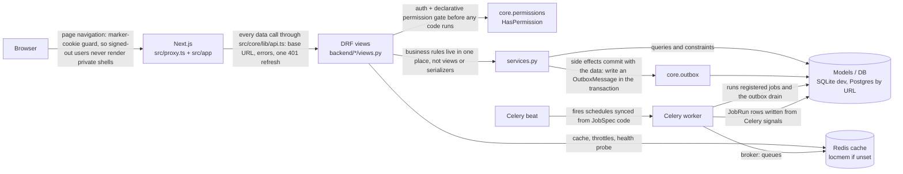

# DjangoBaseX — Architecture

> **Status:** Hub — checked 2026-11-14 · describes what is built: Next.js + DRF + Celery worker/beat + Postgres/SQLite + Redis. Production Docker, webhooks, notifications and Sentry wiring are not built (see [`DOMAIN.md`](DOMAIN.md) 🔜). Detail lives in [`core/ARCHITECTURE.md`](core/ARCHITECTURE.md).

Purpose and priorities: [`PURPOSE.md`](PURPOSE.md) · hard rules: [`INVARIANTS.md`](INVARIANTS.md) · vocabulary: [`DOMAIN.md`](DOMAIN.md) · done means: [`DEFINITION_OF_DONE.md`](DEFINITION_OF_DONE.md).

## Overview

Redis is the dev-stack cache (`CACHE_URL`) and locks store; `CELERY_BROKER_URL` defaults to `memory://` (refused when production-like). Beat runs only under `docker compose --profile scheduler`. Why Celery: [ADR-0012](adr/0012-celery-from-day-one.md). Error tracking: Sentry is decided ([ADR-0013](adr/0013-sentry-only-error-tracking.md)) but not wired, so it is not drawn.

## Layers (`AGENTS.md` § 3, checked against the code)

| Layer | Rule | Gold standard |
|-------|------|---------------|
| Views | Thin: parse, authorize, delegate, respond; inherit `BaseAPIView` / `BaseViewSet` | `backend/users/views.py` |
| Services | All business logic | `backend/users/services/users.py` |
| Serializers | Shape and validate only | `backend/users/serializers.py` |
| Models / querysets | Fields, constraints, `Meta`, custom `QuerySet` methods | `backend/users/models/user.py` |
| Settings | Env via `django-environ`; runtime values via the settings registry | `backend/config/settings.py`, `backend/core/settings_registry.py` |
| Frontend data | Only via `src/core/lib/api.ts`; logic in `src/core/lib/` | `frontend/src/core/lib/users.ts` |

## Dependency rule

Platform apps (`core`, `users`, `rbac`) import only each other, Django and third-party packages; never `project/`, `config`, tests or a plugin ([ADR-0010](adr/0010-platform-layer-is-logical.md)). Registration points outward, imports point inward. Enforced by `backend/tests/architecture/test_core_boundary.py` (`test_the_platform_never_imports_product_or_composition_code`, `test_the_platform_never_imports_a_plugin`) and `backend/tests/architecture/test_plugin_conventions.py` (a plugin imports no other plugin and not `project/`). Frontend: ESLint, see `frontend/src/project/README.md`. Run: `cd backend && uv run pytest tests/architecture -q` and `cd frontend && npm run lint`.

## How to add a new …

Always finish with the gate in `AGENTS.md` § 2 and a `documentation/DAILY_CHANGES.md` entry.

**Django app** (skill `.claude/skills/new-django-app`; `DJANGO_STANDARDS.md` § 2) — copy `backend/users/`.
1. Ask "would every product copied from this want it?" If not, it is product code: `backend/project/` or a plugin.
2. `cd backend && uv run python manage.py startapp <name>`; add to `INSTALLED_APPS` and `known-first-party` in `pyproject.toml` (both protected: ask).
3. Add `<name>/urls.py`, include it from `config/urls.py`; keep `views.py` / `services.py` / `serializers.py` split.
4. Read `DATA_MODEL.md` § 1 before the first model; new platform app: add to `PLATFORM_APPS` in `test_core_boundary.py`.
5. Check: `uv run python manage.py check && uv run python manage.py makemigrations --check --dry-run && uv run pytest`.

**Endpoint** — copy `backend/users/views.py` (`LoginView` for public, a `BaseAPIView` subclass for gated).
1. Subclass `BaseAPIView` (or `BaseViewSet`); set `required_permissions` (`None` denies all, `[]` any signed-in user, codes otherwise).
2. A public view sets `public = True` and its URL name goes in the app's public-routes registration (`backend/users/public_routes.py`).
3. Logic in `services.py`; route in the app's `urls.py`; run `manage.py export_frontend_contracts` so `frontend/src/generated/` follows.
4. Check: `tests/architecture/test_route_enforcement.py` and `test_public_routes.py` pass.

**Permission** — copy `backend/users/permissions.py`.
1. Add a `PermissionSpec("<module>.<feature>.<action>", label)` to the app's `PermissionGroupSpec`.
2. Register the group in `AppConfig.ready()` (`registry.permissions.register(GROUP)`, as `backend/users/apps.py`).
3. Reference it from `required_permissions` and, in the UI, `can()` from `frontend/src/core/lib/permissions.tsx`.
4. Check: `tests/architecture/test_permission_codes.py` (every referenced code is in the catalog, every catalog code is used).

**Plugin** — copy `examples/plugins/notes/`; tooling `scripts/plugins.py`.
1. `cd backend && uv run python ../scripts/plugins.py new <label>` (scaffold from `scripts/plugin_template/`).
2. Fill `plugin.toml` (prefixes derive from the label), models/services/views, and `wiring.py` registrations; never edit core. **Import the platform only through `core.sdk`** (`from core.sdk import registry, NavItem, BaseViewSet, log_activity, …`; versioned, `require_version("1.0")`); `tests/architecture/test_plugins_import_only_sdk.py` fails any other `core.*`, `users` or `rbac` import. A plugin-to-plugin contract is the provider's `contracts.py`, imported by the consumer under `TYPE_CHECKING` only.
3. `uv run python ../scripts/plugins.py link <label>` mounts its `frontend/`; `list` shows state; `registry` regenerates `frontend/src/plugins/registry.generated.ts`.
4. Check: `tests/architecture/test_plugin_conventions.py`, `test_plugins_import_only_sdk.py`, `tests/test_plugins_script.py`, and the plugin's own tests. A plugin is switched off without touching its data by adding its label to the setting `core.plugins.disabled` (`core.plugin_state.set_enabled`).

**Background job** — copy `backend/users/jobs.py`.
1. Declare a `JobSpec` (name `<module>.<verb>`, `func`, queue, `Cron`/`Interval`, `idempotent`, time limits) and `def run(ctx: JobContext) -> int`.
2. Register in `AppConfig.ready()`: `registry.jobs.register(SPEC)` (see `backend/users/apps.py`).
3. Schedules sync on migrate; or `uv run python manage.py sync_schedules`. Job args are primitives only (`core/jobs/dispatch.py`).
4. Check: `uv run pytest tests/core/jobs tests/architecture/test_beat_entries_are_registered.py` and `manage.py doctor --only queue`.

**Runtime setting** — copy `ReauthPolicy` in `backend/users/reauth.py`.
1. Declare a typed dataclass with `meta(Bool|Int|Choice|…)` fields; apply the admission test, `CONFIGURATION.md` § 10.
2. `registry.settings.register_group(Cls, prefix=…, module=…, group=…)` in `ready()`.
3. Read it through `core.settings_service.get_setting`; unread settings fail CI.
4. Update `backend/tests/setting_defaults.json` and add an `UPGRADING.md` note.
   **Moving an existing env value** (e.g. `INVITATION_LIFETIME`) instead of adding one: also follow `CONFIGURATION.md` § 9.14 —
   remove the env read from `backend/config/settings.py` and `backend/.env.example` (**both protected: ask**), drop it from
   `config/settings_test.py`, switch every `settings.<KEY>` reader to the registry, then `rg` the old name → 0 hits.
5. Check: `tests/architecture/test_settings_are_read.py`, `tests/test_setting_defaults_snapshot.py`.

**Feature flag** — declaration `FlagDef` in `backend/core/registry.py`; evaluate with `flag_enabled` / `requires_flag` in `backend/core/flags.py`.
1. `registry.flags.register(FlagDef(key, owner, expires_on, description))` in `ready()`.
2. Gate code with `flag_enabled(key, user=…)`; for a guard (`off|log_only|enforce`) use `register_guard` + `check_guard` in `backend/core/guards.py` instead.
3. Delete the declaration and the dead branch before `expires_on`.
4. Check: `tests/architecture/test_no_expired_flags.py`, `tests/test_flags.py`.

**Frontend page / module** — copy `frontend/src/core/modules/users/` and `frontend/src/app/(core)/users/`.
1. Product routes go in `src/app/(project)/`, logic in `src/project/lib/`; project may import core, never the reverse.
2. Data through `src/core/lib/api.ts`; gate with `can()`.
3. Register a `NavItem` from the backend (see `backend/users/navigation.py`): navigation is also the route gate, so a page without an entry is refused.
4. Strings go through the i18n catalogues (`src/core/messages/`); tones through `registry.statuses`.
5. Check: `cd frontend && npm run lint && npm run typecheck && npm test`. Plugin pages: `frontend/src/core/lib/plugin-pages.ts`.
